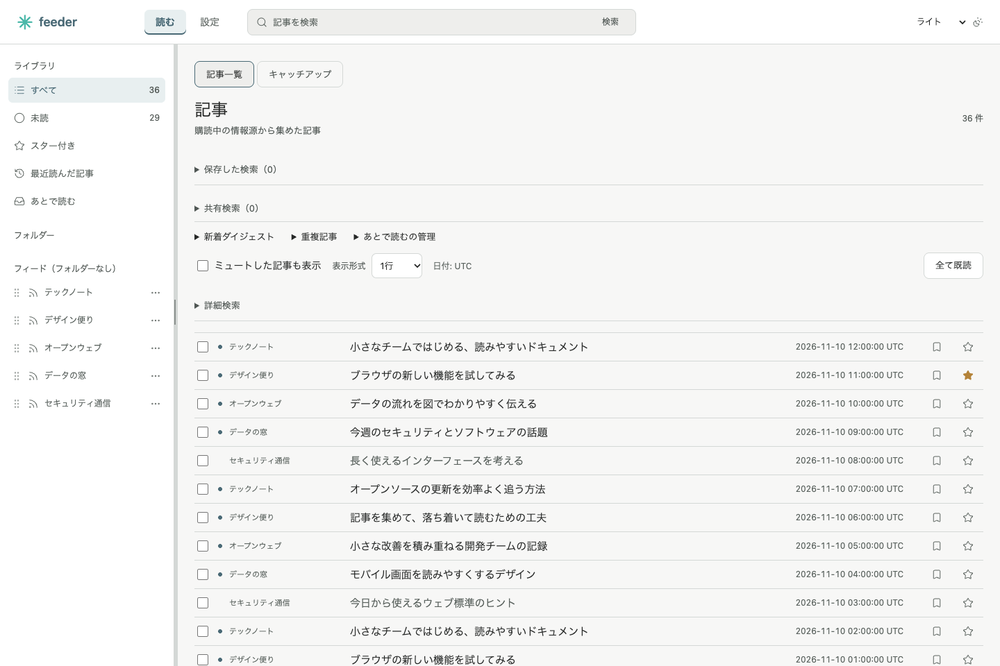
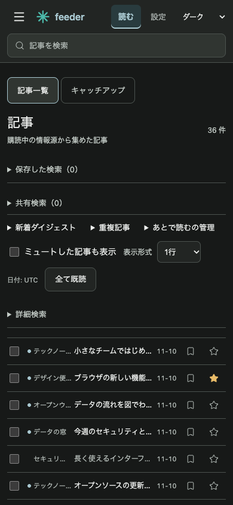

# Feeder

Feeder は、RSS・Atomと公開SNSの情報を集めて読むための、セルフホスト型Webリーダーです。Rust製バックエンドとReact／TypeScript製フロントエンドを、Linuxコンテナで実行します。

## デモ画面

PCとモバイルで、記事一覧・検索・既読管理を利用できます。画面内の記事とフィードはデモ用の架空データです。





## 主な機能

- RSS／Atomと公開Mastodon・Blueskyの購読、定期収集、収集状態の確認
- フォルダー、検索、保存検索、既読、スター、あとで読む、ミュート
- 関心語と優先フィードに基づくキャッチアップ、記事の更新履歴、関連記事、重複記事の確認
- 標準・1行・タイル表示、モバイル対応、ライト／ダークテーマ
- OPMLによる購読の入出力、設定JSONの書き出しとプレビュー付き読み込み
- APIキーによる外部クライアントからのアクセス

## Linuxコンテナで起動

Docker EngineとCompose v2を用意し、リポジトリのルートで実行します。

```sh
docker compose config --quiet
docker compose build --pull
docker compose up -d --wait
```

設定を変更する場合は `cp .env.example .env` で `.env` を作成し、必要な値を設定してください。[環境変数とAPIキー](docs/runtime-config.md)に設定方法を記載しています。

`http://127.0.0.1:8080` を開きます。Webと定期収集workerが専用ボリュームのデータを共有します。初期状態は空のライブラリで、自動収集は有効です。デモ用の記事が必要な検証環境では `FEEDER_DEMO=1` を指定できます。

## 購読と読書

「設定」でサイトまたはRSS／AtomのURLを入力し、フィードをプレビューしてから登録します。公開Mastodon・Blueskyアカウントの購読も設定画面から追加できます。フィードごとに収集間隔を変更でき、停止しても保存済みの記事は残ります。購読を削除すると、その購読の記事も削除されます。

一覧では既読・スター・あとで読むの状態を管理でき、検索条件の保存や条件に一致する記事の一括操作も行えます。記事詳細には、収集後に観測した更新履歴や関連記事を表示します。キャッチアップは関心語や優先フィードを基に記事を選び、選定理由と収集不足の可能性を示します。

OPMLの取り込みは事前に内容を確認できます。設定JSONは共有設定と一部のブラウザ表示を復元できますが、記事・既読状態を含む完全バックアップではありません。[設定の持ち出し](docs/reader-settings-export.md)と[OPMLの仕様](docs/opml.md)を参照してください。

## 運用とデータ保全

更新前はWebとworkerを停止し、専用ボリュームのデータ全体をバックアップしてください。[配備・バックアップ・復元手順](docs/deployment.md)に整合性検証と別ボリュームでの復元手順を記載しています。

標準構成はホストのループバックからの利用を前提とします。外部公開する場合は、[アクセス制御とAPIキー](docs/api-access-control.md)の認証・ネットワーク構成を確認してください。SNSの取得完全性や外部サービスの可用性は保証されません。

## 開発と検証

```sh
cargo test --manifest-path backend/Cargo.toml --locked
npm --prefix frontend run build
docker build --target backend-test .
python3 scripts/container-smoke.py
```

コンテナ検証スクリプトは、専用の一時プロジェクトと合成データを使用し、検証後にそれらを削除します。実装状況と既知の制限は[残タスク](docs/remaining-port-tasks.md)を参照してください。
